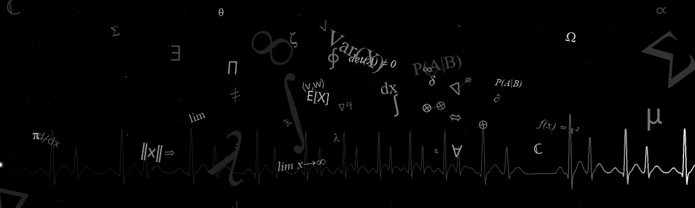

<!-- ========================================================= -->
<!-- THE OPENING -->
<!-- ========================================================= -->

  

<h1 align="center">ASAD MASOOD KIDWAI</h1>

  <code>COMPUTER SCIENCE STUDENT</code> &nbsp;·&nbsp;
  <code>QUESTION COLLECTOR</code> &nbsp;·&nbsp;
  <code>PROFESSIONAL OVERTHINKER</code>

  ISLAMABAD, PK &nbsp; / &nbsp; FAST-NUCES &nbsp; / &nbsp; CURRENTLY FIGURING THINGS OUT

<i>Somewhere between mathematical elegance and questionable experiments.</i>

 

<!-- ========================================================= -->
<!-- 01 / THE SIGNAL -->
<!-- ========================================================= -->

<h2>01 &nbsp; / &nbsp; THE SIGNAL</h2>

<table>
<tr>
<td width="58%" valign="top">

### HELLO, INTERNET.

I'm a Computer Science student interested in understanding how things work beneath the surface.

I like mathematics, intelligent systems, algorithms, and the occasional idea that turns into a much bigger project than initially intended.

I'm particularly drawn to the intersection of **mathematical foundations and computation**: understanding not just how to build something, but why it works, where it fails, and what makes it interesting in the first place.

Currently exploring AI and machine learning, optimization, theoretical computer science, and whatever rabbit hole catches my attention next.

<blockquote>
<i>“Somewhere between mathematical elegance and questionable experiments.”</i>
</blockquote>

</td>
<td width="42%" valign="top">

### SYSTEM STATUS

| PROCESS | STATUS |
|:--|:--|
| THINKING | ACTIVE |
| BUILDING | ACTIVE |
| QUESTIONING | CONSTANT |
| OVERTHINKING | UNBOUNDED |

 

**OPEN TABS**

- Brain tabs: too many
- Explanations: occasionally held together by vibes
- Confidence: sometimes exceeds available evidence
- Bugs: considered unexpected research opportunities

</td>
</tr>
</table>

---

<!-- ========================================================= -->
<!-- 02 / INTERESTS -->
<!-- ========================================================= -->

<h2>02 &nbsp; / &nbsp; THINGS THAT KEEP ME UP</h2>

<table>
<tr>
<td width="33%" valign="top">

### 01 — INTELLIGENCE

- Artificial Intelligence
- Machine Learning
- Reinforcement Learning
- AI Agents
- Foundations of ML

</td>
<td width="33%" valign="top">

### 02 — MATHEMATICS

- Optimization
- Probability & Statistics
- Mathematical Foundations
- Learning Theory
- Applied Mathematics

</td>
<td width="33%" valign="top">

### 03 — COMPUTATION

- Algorithms & Theoretical CS
- Graph Theory
- Network Science
- Data Management
- Information Retrieval

</td>
</tr>
</table>

  THE COMMON THREAD: UNDERSTANDING COMPLEX SYSTEMS.

---

<!-- ========================================================= -->
<!-- 03 / WORKBENCH -->
<!-- ========================================================= -->

<h2>03 &nbsp; / &nbsp; THINGS I'VE BEEN BUILDING</h2>

  THREE PROJECTS. THREE DIFFERENT PROBLEMS. A REASONABLE AMOUNT OF QUESTIONABLE DECISION-MAKING.

<table>
<tr>
<td width="50%" valign="top">

### 01. COIN

`PYTHON` `AI MODELS` `FINBERT` `KRONOS` `PAYPAL API`

**An AI board of directors for paper trading.**

Four specialist analysts examine the market from different perspectives: technical indicators, price forecasts, financial sentiment, and company fundamentals.

Their findings go to a reasoning-model Chair, which decides whether to buy, sell, or ignore an opportunity.

The system also includes a rule-based Risk Firewall, an adaptive student model, automated trading, and a virtual vault with PayPal sandbox deposits and payouts.

**The interesting part:** building a system where multiple specialised models reason together, while independent rules keep their decisions in check.

<a href="https://github.com/asadmasoodkidwai/coin">↗ EXPLORE THE REPOSITORY</a>

NOTE: PAPER TRADING ONLY. SANDBOX FUNDS AND UNOFFICIAL MARKET DATA.

</td>
<td width="50%" valign="top">

### 02. BAADAL

`PYTHON` `QISKIT` `QAOA` `QUANTUM AMPLITUDE ESTIMATION`

**Quantum-assisted disaster response planning for Pakistan.**

What if weather forecasts, flood modelling, and quantum algorithms could help inform decisions during a flood?

Built for **Qiskit Fall Fest 2026**, Baadal explores a pipeline that monitors weather across Pakistani cities, estimates flood risk, models potential impact, and selects protective measures under a limited budget.

It brings together quantum amplitude estimation, QAOA, geospatial data, and classical comparisons.

I initiated the concept, helped shape its direction, suggested improvements, and contributed to implementation.

**The interesting part:** exploring where quantum optimisation and estimation might fit into a real-world decision-making problem.

<a href="https://github.com/1WhiteDeath1/baadal">↗ EXPLORE THE REPOSITORY</a>

COLLABORATIVE PROJECT · QISKIT FALL FEST 2026

</td>
</tr>
<tr>
<td colspan="2" valign="top">

### 03. MODEL KOMBAT

`PYTHON` `AI` `GAME AUTOMATION`

**An autonomous fighting agent for Street Fighter II.**

The challenge was to build an agent that could interpret game states, make decisions in real time, and fight inside an emulator without a human controlling every move.

I contributed to the development of the autonomous agent as part of an AI competition.

**The interesting part:** turning a game environment into a problem of perception, decision-making, and automated control.

COMPLETED PROJECT · CONTRIBUTOR

</td>
</tr>
</table>

---

<!-- ========================================================= -->
<!-- 04 / TOOLBOX -->
<!-- ========================================================= -->

<h2>04 &nbsp; / &nbsp; THE TOOLBOX</h2>

<i>Tools are tools. Knowing what to do with them is the fun part.</i>

  
  &nbsp;
  

  CLAUDE — THE GOAT.

  ALWAYS LEARNING SOMETHING NEW. SOMETIMES EVEN THE THING I SET OUT TO LEARN.

---

<!-- ========================================================= -->
<!-- 05 / ACTIVE PROCESSES -->
<!-- ========================================================= -->

<h2>05 &nbsp; / &nbsp; CURRENTLY DOWN THE RABBIT HOLE</h2>

<table>
<tr>
<td width="50%" valign="top">

**RESEARCH INTERESTS**

- Foundations of machine learning
- Reinforcement learning and AI agents
- Optimization and learning theory
- Graph ML and network science
- Theoretical computer science

</td>
<td width="50%" valign="top">

**QUESTIONS I'M EXPLORING**

- What makes an intelligent system actually intelligent?
- How much can mathematical structure tell us about learning?
- Where do optimization methods succeed or fail?
- How do complex behaviours emerge from simpler systems?
- What happens when theory meets implementation?

</td>
</tr>
</table>

  <i>Not all questions have answers. Some just lead to better questions.</i>

---

<!-- ========================================================= -->
<!-- 06 / OPERATING PRINCIPLES -->
<!-- ========================================================= -->

<h2>06 &nbsp; / &nbsp; OPERATING PRINCIPLES</h2>

<table>
<tr>
<td width="50%" valign="top">

**01.** Understand the problem before solving it.

**02.** Being wrong is useful. Staying wrong isn't.

</td>
<td width="50%" valign="top">

**03.** Elegant solutions are worth pursuing.

**04.** Curiosity should occasionally be allowed to run unsupervised.

</td>
</tr>
</table>

---

<!-- ========================================================= -->
<!-- END / STILL RUNNING -->
<!-- ========================================================= -->

  ────────────────────────────────────────────────────────

<h2 align="center">∀ QUESTIONS, ∃ MORE QUESTIONS.</h2>

  <i>Still learning. Still building. Still asking why.</i>

  <code>END OF TRANSMISSION. PROBABLY.</code>

  LAST KNOWN LOCATION: SOMEWHERE DOWN A RESEARCH RABBIT HOLE

